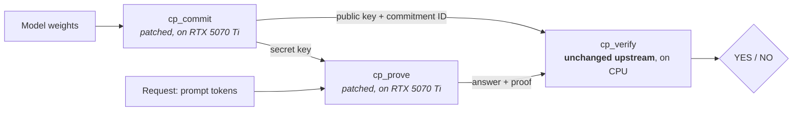

<p align="center">
  
</p>

<h1 align="center">Provable AI inference on a consumer GPU</h1>

<p align="center">
  <em>Anthropic's FlashProve, running on a $750 GeForce RTX 5070 Ti.<br>
  Every proof checked by the unchanged upstream verifier. Every limit written down.</em>
</p>

<p align="center">
  
  
  
  
  
</p>

---

When an AI system answers, how do you know **which model** produced the answer?

[FlashProve](https://github.com/anthropics/FlashProve) is Anthropic's open-source research prototype that answers this with a
zero-knowledge proof: a reply provably came from a specific, committed set of model weights. Anyone can check the proof on an
ordinary CPU. Upstream supports one prover platform: a dedicated **NVIDIA H100**.

We wanted to know what it takes to run it on hardware a developer can buy at a store.

> **Answer:** 12 small patches to the prover (none to the verifier), one consumer GPU, and careful bookkeeping of what the result
> does and does not mean.

## At a glance

| | |
|---|---|
| **Hardware** | GeForce RTX 5070 Ti (consumer Blackwell, compute capability 12.0, 16 GB), which also drives the desktop; Windows 11 + WSL2 Ubuntu 24.04 |
| **Upstream** | `anthropics/FlashProve` @ `9e2bdd8f` (v0.16.0) |
| **Patches** | 12 files, +34 / −28 lines to the prover. **0 changes** to the verifier, protocol, or proof format. A 13th patch (from [FlashProve-L4](https://github.com/zkwasm/FlashProve-L4)) adds one small model shape. |
| **Judge** | Upstream's `cp_verify`, built separately from a pristine checkout. The binary is identical (sha256 `7f9efc1e…4394`) across three independent builds |
| **Real model** | Karpathy's [TinyStories260K](https://huggingface.co/karpathy/tinyllamas), in FlashProve-L4's integer conversion. Answer token **310** in every run |
| **Speed** (tiny models, n = 3) | about 2 s to prove, 5–25 s to commit, about 0.7 s to verify on a CPU |

## How it works



**Why patching the prover doesn't weaken anything:** in FlashProve, soundness is a property of the **verifier**. A buggy or
modified prover can only produce proofs that are *rejected*. So every result here is judged by the untouched upstream verifier, and
we publish the tamper tests showing it still rejects what it should.

## Results

| Experiment | Build | Model | Fresh proofs accepted | Tampered inputs rejected |
|---|---|---|---|---|
| **A5:** first port | test | upstream's synthetic 8-layer example | 3 / 3 | 18 / 18 |
| **A6:** clean room, from these patch files only | test | the same | 3 / 3 | 18 / 18 |
| **A8:** production build | default (serving) | the same | 3 / 3 | 18 / 18 |
| **A9:** real pretrained model | default (serving) | TinyStories260K (FlashProve-L4 conversion) | 3 / 3, **token 310** each time | 15 / 15 |

**The tamper tests:**
- a flipped proof bit, a truncated proof, or a flipped request bit → `NO: proof-refused`;
- answer + 1 → `NO: reply-differs`;
- the wrong commitment ID or another model's public key → `NO: model-statement`.

**A10, a float cross-check:** our own dependency-free implementation of TinyStories260K reproduces Karpathy's published greedy sample word for
word. At the proved position it also picks token 310 (`"ily"`, completing "Lily"), with a logit margin of 6.7. The checkpoint's hash
matches Hugging Face's.

**Cross-hardware:** FlashProve-L4's own published proof, made on an NVIDIA L4, is accepted by our verifier. Our proofs, made on Blackwell,
give the same answer token as theirs.

Full write-ups are in [`docs/RESULTS.md`](docs/RESULTS.md). Raw logs and checksums for every run are in [`evidence/`](evidence/).

## What it took: the 12 patches

The H100 lets a GPU kernel use up to 227 KB of fast on-chip (shared) memory; this card allows 99 KB. Most of the work was there.

| # | Where | Change | Why it keeps values exact |
|---|---|---|---|
| 1 | `prover/build.sh` | `-arch=sm_90a` → `sm_120` | native code from the pinned nvcc 13.2.86 |
| 2 | `prover/base.cuh` | `k_ws<4,32>` → `<4,16>` | integer sums, regrouped (static shared memory 59 KB > 48 KB) |
| 3 | `hf_range_windows.cuh` | `COUNT_BITS` 15 → 14 | upstream's split / two-pass path |
| 4 | `engine/tiled.cuh` | `TILED_STAGES` 3 → 2 | double instead of triple buffering; exact int8 MMA |
| 5 | `hf_commit_once.cuh` | engine reservation 24 → 6 GiB | memory policy; upstream: *"No byte of an output file depends on this number"* |
| 6 | `weights_blocks/experts.cuh` | `EXPERTS_IN_ONE_LAUNCH` 1 → 0 | upstream's cuBLAS host-loop form |
| 7 | `hiding/forest_table.cuh` | attribute 128 → 64 KiB | launches stay within it |
| 8 | `hiding/count_keys16.cuh` | 2 halves → 4 quarters | each key counted once |
| 9 | `engine/fold.cuh` | limit 100 → 96 KiB | upstream's field-arithmetic fallback |
| 10 | `hiding/forest_keys.cuh` | table read from global memory | the same read-only values |
| 11 | `hiding/forest.cuh` | `FOREST_FUSED` 1 → 0 | upstream's cuBLASLt mode |
| 12 | `hf_keeper.cu` | `cudaMallocHost` instead of `cudaHostRegister` | under WSL2/WDDM a registered host pointer is unusable in kernels (known behaviour, e.g. in exllamav3) |

The FlashProve-L4 project, working independently on an NVIDIA L4, changed largely the same kernels. We read that as good corroboration.

## What this does **not** show

We think this section matters more than the results.

- **Not a statement about any served or large model.** The A9 proof is about committed *integers*: TinyStories weights as
  converted by FlashProve-L4 and run as upstream's integer model. That is not the floating-point model, although at the proved position both agree.
- **Tiny models only** (260K parameters). It says nothing yet about what fits in 16 GB. That is our next experiment.
- **Not formally verified.** Upstream's Lean verifier accepts only its full-size format. Our `YES` comes from the C++ verifier,
  which is tested, not proved.
- **Weight hiding is not demonstrated.** `cp_verify` never checks it; the production build is the one designed to hide weights.
- **One machine, WSL2 only, not yet independently replicated.** Native Linux is untested.
- **No performance claim.** Timings are n = 3 wall-clock runs on a desktop machine.
- **Not "the first".** [FlashProve-L4](https://github.com/zkwasm/FlashProve-L4) ported the prover to non-H100 NVIDIA
  hardware with a real model earlier, and an [Apple Silicon rewrite](https://github.com/jp4g/flashprove-mlx) proved off the H100 before that.

## Reproduce it

**You need:** an RTX 30/40/50-series GPU (we tested sm_120; sm_86 and sm_89 are expected to work, but that is untested), Ubuntu 24.04 (WSL2 or
native), g++ 13, python3, and about 10 minutes per build. **Before a production run, GPU memory in use must be under about 1.5 GiB**,
because the programs refuse to start above 2 GiB, counting their own memory.

```bash
# 1. The pinned compiler (no root): nvcc 13.2.86 from NVIDIA's pip packages
bash scripts/a2_install_cuda.sh

# 2. Two clones of upstream at the pin: one pristine (the judge), one to patch
git clone https://github.com/anthropics/FlashProve judge && git -C judge checkout 9e2bdd8ff5bf9c62f18263d7dac189b0400b260c
git clone https://github.com/anthropics/FlashProve prover && git -C prover checkout -b consumer-gpu 9e2bdd8ff5bf9c62f18263d7dac189b0400b260c
git -C prover am "$PWD"/patches/00{01..12}-*.patch

# 3. Build the judge, then the patched prover (the verifier first: cp_commit keeps a copy for its self-check)
(cd judge && verifier/build.sh && sha256sum bin/cp_verify)
(cd prover && verifier/build.sh && cd prover && ./build.sh)      # or ./build.sh tests

# 4. Commit, prove and verify the bundled synthetic example (production build in prover/prover/build/hc;
#    for a test build add BUILD=$PWD/prover/prover/build/hc/test_build in front)
prover/prover/examples/run_target_example.sh target_small_f2_roomy "$HOME/run1"

# 5. Judge again with the PRISTINE verifier and run the tamper set
#    (if your compiler gives another cp_verify binary, also set EXPECT_V=<sha256 of judge/bin/cp_verify>)
JUDGE=$PWD/judge WBASE=$HOME bash scripts/a5_verify_and_tamper.sh run1
```

For the real-model run (A9), add `patches/0013-*.patch`, fetch FlashProve-L4 @ `eac41543` and check its `MANIFEST.json`, then
follow `scripts/a9_real_model.sh`. The scripts were written for one machine: paths appear as `$HOME` and `${WHY_ROOT}`, so adjust them.

## 🙋 Help us replicate

The single most useful contribution is **running this on your GPU**, especially another consumer card or native Linux.
Open a [replication report](../../issues/new?template=replication-report.yml) with:
- the exit code and last line from `cp_verify`;
- the commitment ID and answer token;
- your GPU, driver and OS.

Failures are just as welcome as successes.

## Where this is going

This repository is the first public result of **WHY Research's** work on *verifiable evidence for AI agents*. AI agents are
starting to act: they call tools, move data and approve changes. Today the record of what an agent did is mostly logs. We are
working on evidence that says plainly **how much it proves**: observed, signed, hardware-attested, or computation-proven. Small
guard models that approve or block an agent's action are exactly the size that proofs reach today, on hardware like this.

Next up:
1. **Scaling study:** how large a model can be committed and proven within 16 GB.
2. **A provable guard decision** bound to a signed agent-action receipt.

Follow along at [why.com/research](https://why.com/research.html) · [X @whydots](https://x.com/whydots) · [Discord](https://discord.gg/raAQCeDr3e).

## Credits and licence

- **FlashProve** © Anthropic PBC, Apache-2.0. This repository contains patches to it, not a fork of it.
- **Patch 13** is the unchanged model-shape hunks of [zkwasm/FlashProve-L4](https://github.com/zkwasm/FlashProve-L4) @ `eac41543`, Apache-2.0.
- **TinyStories260K** © Andrej Karpathy, MIT. It is not included here.
- Everything else is © 2026 Ockams, Inc. (WHY), [Apache-2.0](LICENSE). See [NOTICE](NOTICE).

If you use this work, please cite it ([`CITATION.cff`](CITATION.cff)).
